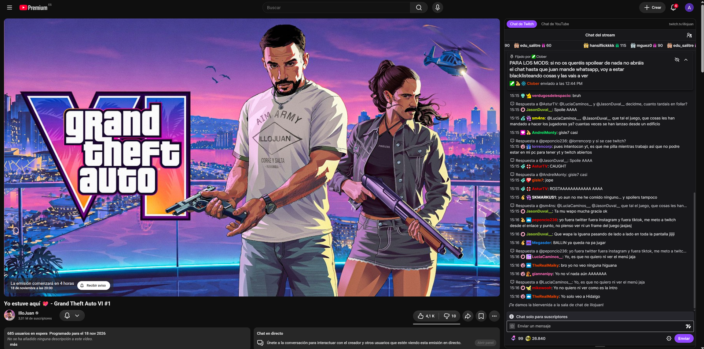
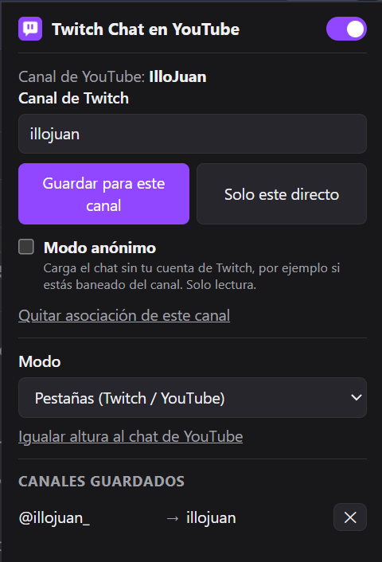

# Twitch Chat en YouTube

Extensión de Chrome (Manifest V3) que muestra el chat de Twitch dentro de los directos de YouTube.
El código es corto y se puede revisar en unos minutos.

## Qué hace (y qué no)

- Inserta el **chat embebido oficial de Twitch** (`https://www.twitch.tv/embed/<canal>/chat`) junto al chat de YouTube.
- Guardas qué canal de Twitch corresponde a cada canal de YouTube; la próxima vez aparece solo.
- Tres modos: pestañas (Twitch / YouTube), ambos apilados, o sustituir el chat de YouTube.
- Por defecto el chat de Twitch mide lo mismo que el de YouTube. Puedes cambiar la altura arrastrando el tirador
  del borde inferior (se recuerda); doble clic en el tirador para volver a igualarla.
- Sigue el tema claro/oscuro de YouTube.
- **Modo anónimo** (por canal): carga el chat sin tu cuenta de Twitch, en solo lectura. Útil, por ejemplo,
  si tu cuenta está baneada en ese canal. Usa un iframe `credentialless` de Chrome, que no envía tus cookies.

Privacidad:
- Único permiso: `storage` (guardar tus asociaciones de canales en `chrome.storage.sync`).
- Solo se ejecuta en `https://www.youtube.com/*`.
- No hay background script, ni analítica, ni peticiones a servidores propios, ni código remoto.
  La única conexión externa es el iframe de Twitch, igual que si abrieras el chat en twitch.tv.

## Instalación

1. Descarga el código (`git clone` o **Code → Download ZIP** y descomprímelo) en una carpeta que no vayas a borrar.
2. Abre `chrome://extensions` y activa **Modo de desarrollador** (arriba a la derecha).
3. Pulsa **Cargar descomprimida** y elige la carpeta.
4. Fija el icono en la barra (icono del puzle → chincheta).

## Uso

1. Abre un directo de YouTube (si ya estaba abierto, recarga la pestaña).
2. Pulsa el icono de la extensión, escribe el canal de Twitch (nombre o enlace `twitch.tv/...`).
3. **Guardar para este canal** lo recuerda siempre; **Solo este directo** lo aplica solo a la página actual.

## Notas

- Para escribir en el chat tienes que tener la sesión iniciada en twitch.tv en el mismo navegador.
  Si te pide iniciar sesión dentro del panel, comprueba que no bloqueas las cookies de terceros para
  `twitch.tv` (`chrome://settings/cookies` → Sitios que pueden usar cookies de terceros → añadir `[*.]twitch.tv`).
- YouTube cambia su HTML de vez en cuando. Si el panel deja de aparecer, lo más probable es que haya que
  actualizar los selectores en `getYouTubeChannel()` / `getYouTubeChat()` de `content.js`.

## Actualizar

Descarga la nueva versión en la misma carpeta, pulsa ↻ en la extensión en `chrome://extensions` y recarga la pestaña de YouTube.

## Archivos

| Archivo | Para qué sirve |
|---|---|
| `manifest.json` | Declaración de la extensión y permisos |
| `content.js` / `content.css` | Inserta y gestiona el panel en YouTube |
| `popup.html` / `popup.js` / `popup.css` | Ventana de configuración del icono |
| `icons/` | Iconos |

## Licencia

MIT. Consulta [LICENSE](LICENSE).
